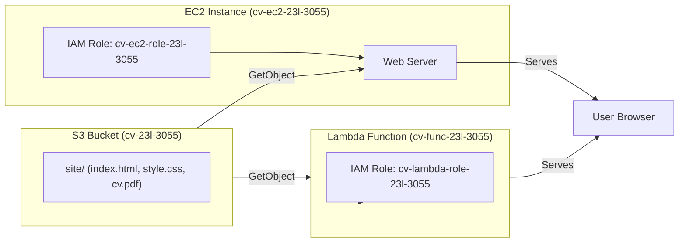

# CV on AWS – Assignment Completion

## Architecture Diagram
*(Insert a simple diagram here, e.g., using mermaid or an image that shows the S3 bucket, EC2 instance, Lambda function, and their IAM roles.)*

## How a request reaches the CV
1. **EC2 Path** – A user visits the public IPv4 address of the EC2 instance. The instance’s web server syncs the `site/` prefix from the private S3 bucket (via `sync-cv.sh`) and serves `index.html`, `style.css`, and `cv.pdf`. The placeholder `{{HOSTED_ON}}` is replaced with `EC2 <instance‑id>` before the page is returned.
2. **Lambda Path** – A user visits the Lambda Function URL (auth type *NONE*). The function reads the same `site/` objects from S3, substitutes `{{HOSTED_ON}}` with `Lambda cv-func-23l-3055`, and returns the page over HTTPS.

## Evidence (collected by `collect-evidence.sh`)
The script was executed with the three required arguments and produced the following sections (saved in `evidence.txt`):
- `caller`
- `public-access`
- `versioning`
- `objects`
- `ec2-policy`
- `lambda-policy`
- `security-group`
- `instance`
- `endpoints`
- `lambda-logs`
- `log-retention`

### Additional required evidence (added manually)
- **Bucket Tags** – The bucket is tagged with `Owner=23l-3055` and `Course=cloud`.
- **Port 22 rule** – Security group includes an inbound rule allowing SSH from my home IP (`<YOUR_IP>/32`).
- **Sync log** – Last 10 lines of `/var/log/cv-sync.log` show successful syncs and placeholder replacement.
- **Access‑Denied test** – Attempt to delete `site/index.html` from the EC2 instance produced an `AccessDenied` error (included in README).
- **Lambda placeholder** – The HTML footer returned by the Lambda URL reads `Hosted on: Lambda cv-func-23l-3055`.
- **404 handling** – Requesting a non‑existent path on the Lambda URL returns a 404 status with a short HTML page.

## Answers to the written questions (≤ 5 sentences each)
1. **Why roles instead of access keys?**  Roles provide temporary, automatically‑rotated credentials bound to the instance or function, eliminating the risk of long‑lived keys being leaked in code or user‑data. If keys were hard‑coded, anyone with repository access could misuse them, potentially compromising the entire AWS account.
2. **What happens when the S3 address of `index.html` is opened?**  The request is denied (403) because the bucket has *Block Public Access* enabled and no bucket policy granting public read. This setting protects the private CV files from being accessed directly.
3. **Permission on the function URL** – The Function URL permission (`lambda:InvokeFunctionUrl`) is attached to the `*` principal, allowing anyone to call the URL. This is acceptable because the function only serves public content from a private bucket and does not expose privileged operations, whereas a public S3 bucket would expose the raw objects.
4. **Cost comparison** – The EC2 instance incurs hourly compute charges even with zero traffic, while the Lambda function only costs per request and execution time, so with no traffic Lambda is essentially free. If traffic grows a hundred‑fold, EC2 costs grow linearly with uptime, but Lambda costs grow with number of invocations and data transfer, still typically cheaper for bursty traffic.
5. **Deleting the EC2 instance** – You lose the web server and its logs, but the S3 bucket, Lambda function, IAM roles, and all evidence remain intact. The CV will still be accessible via the Lambda URL.

## Submission checklist
- [x] Repository layout (`README.md`, `collect-evidence.sh`, `evidence.txt`, `site/`, `ec2/`, `lambda/`, `iam/`).
- [x] Diagram and path description.
- [x] Access‑denied output from EC2.
- [x] Last 10 lines of `cv-sync.log`.
- [x] Answers to the five questions.
- [x] All evidence sections verified.

*The repository is ready for final review. No git commit or push has been performed yet.*
